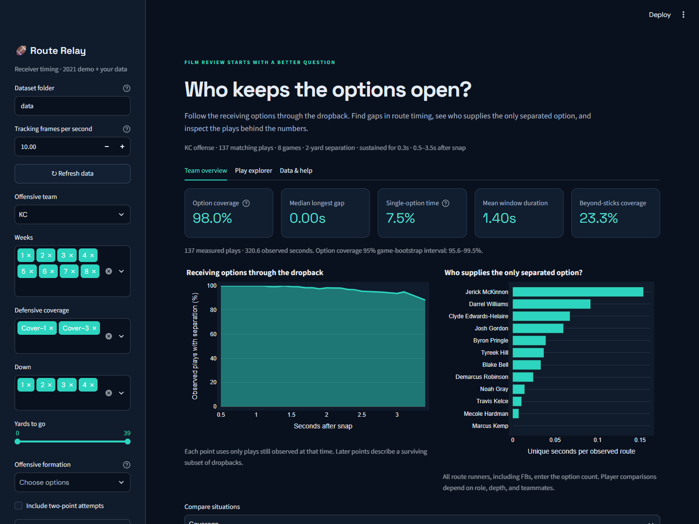

# Route Relay

**An NFL receiver-timing dashboard that shows when an offense has a separated option, when every option disappears, and which WR, TE, or RB keeps the play alive.**

[Live Streamlit dashboard](https://nflrouteplay.streamlit.app/) | [Static interactive demo](https://abhishekmuhuri.github.io/nfl-big-data-bowl-regional-event-data_Sol/) | [Detailed methods](docs/METHODS.md)



## What we built

Route Relay is a Python and Streamlit analysis tool for NFL coaches and analysts. It studies how the separation windows of every route runner work together during a dropback instead of grading receivers only one at a time.

The tool answers one practical football question:

> **Does the route combination keep at least one separated receiving option available, and who supplies that option when nobody else does?**

The dashboard provides team and situation filters, five new timing metrics, player contribution tables, a receiver-window timeline, an animated all-22 replay, downloadable evidence, and a validated pipeline for adding new games.

## Why an NFL team would use it

A receiver can be open in isolation while the overall route concept still has poor timing. Two windows may occur at the same time and then leave a gap, an outlet may become available too late, or a TE/RB may be the only player preventing the quarterback from having no separated option.

Route Relay helps an offensive coach or analyst:

- Find plays with long periods where no route runner has qualifying separation.
- Identify which player provides the only separated option.
- Compare route timing against different coverages, formations, downs, and distances.
- Separate ordinary open space from separation located beyond the first-down line.
- Create a targeted film-review queue rather than manually searching thousands of plays.
- Test whether an observation remains true under stricter separation or duration settings.

The result is not an automatic play-call recommendation. It helps coaches find the right plays and questions for film study and practice experiments.

## Original insight

Most receiver-separation metrics focus on an individual at a single moment. Route Relay treats the receiving group as a connected system and measures how individual windows **relay** from one player to another.

The default reproducible analysis examines 137 Kansas City plays against Cover-1 and Cover-3 across eight games. With separation defined as at least 2 yards for 0.3 seconds between 0.5 and 3.5 seconds after the snap:

| Finding | Result |
| --- | ---: |
| Option Coverage | 98.0% |
| Median Longest Gap | 0.00 seconds |
| Single-option time | 7.5% |
| Mean receiver window | 1.40 seconds |
| Beyond-Sticks Coverage | 23.3% |
| Plays where a TE/RB supplied the only option | 22 of 137 (16.1%) |
| TE/RB unique-option time | 13.5 seconds |

The main finding is that **separation somewhere on the field was common, but separation at first-down depth was much less common**. TEs and RBs also supplied the only separated option on 16.1% of these plays. For a coach, that creates a useful distinction between a concept that technically provides space and one that provides useful space at the required depth.

The exact supporting files are committed as [findings.json](docs/findings.json), [play-level evidence](docs/demo_play_metrics.csv), and [receiver-level evidence](docs/demo_receiver_metrics.csv).

## Metrics

| Metric | Meaning |
| --- | --- |
| **Option Coverage** | Percentage of valid observed time with at least one sustained separated route runner. |
| **Longest Gap** | Longest continuous observed period with no qualifying option. |
| **Unique Contribution** | Time when one receiver supplies the only qualifying option. |
| **Mean Window Duration** | Average duration of a receiver's qualifying windows. |
| **Beyond-Sticks Coverage** | Percentage of known-line observed time with a separated receiver at or beyond the first-down line. |

A route runner qualifies by default when the nearest of all 11 defenders remains at least **2 yards away for 0.3 seconds**. The dashboard allows the analyst to change the distance, duration, and time interval.

## What judges can see in the dashboard

### Team Overview

- Five headline metrics with clear definitions.
- Option availability through the dropback.
- Receiver unique contribution per observed route.
- Comparisons by coverage, formation, down and distance, or receiver combination.
- Sample-size flags and a game-cluster bootstrap interval.
- Downloadable play and receiver CSV files.

### Play Explorer

- Sort plays by longest gap, highest coverage, or lowest coverage.
- View each receiver's separation windows on a shared timeline.
- Replay all 22 players and the football on a normalized field.
- See the line of scrimmage, first-down line, measured exposure, and data-quality warnings.

### Data & Help

- Upload new supporting/tracking CSVs or a ZIP.
- Inspect exclusions, missing frames, censored clips, and other quality fields.
- Change the tracking frame rate for a new feed through an explicit reprocessing action.
- Download the quality report.

## Quick start

### Windows - simplest method

1. Click **Code -> Download ZIP** on GitHub.
2. Extract the complete ZIP to a writable folder.
3. Install [Python 3.12 or newer](https://www.python.org/downloads/) and select **Add Python to PATH**.
4. Double-click `START_WINDOWS.bat`.
5. Keep the terminal window open. The dashboard opens at `http://localhost:8501`.

The launcher creates a private `.venv`, installs the pinned dependencies, and loads the included demo from a validated prepared cache. New or changed games are processed from their raw tracking CSVs and reused on later launches.

### macOS or Linux

Open a terminal in the repository folder and run:

```sh
python3 start.py
```

### Manual setup

```sh
python -m venv .venv
```

Activate the environment:

```powershell
# Windows PowerShell
.\.venv\Scripts\Activate.ps1
```

```sh
# macOS/Linux
source .venv/bin/activate
```

Install and launch:

```sh
python -m pip install -r requirements.txt
python process_data.py
python -m streamlit run app.py
```

## Suggested two-minute judge walkthrough

1. Open **Team Overview** and compare Option Coverage with Beyond-Sticks Coverage.
2. Change **Compare situations** between coverage, formation, and down-and-distance.
3. Review the player contribution table to see who supplies the only option.
4. Open **Play Explorer** and sort by **Longest receiving gap**.
5. Inspect the timeline and animated replay for the selected play.
6. Increase the separation threshold from 2 to 3 yards under **Measurement settings** to test robustness.

## Method

```text
games + plays + players + PFF scouting + tracking CSVs
                         |
                         v
          schema, key, roster, and frame validation
                         |
                         v
       direction normalization and event-window detection
                         |
                         v
   nearest-defender distance for every route runner and frame
                         |
                         v
      sustained windows and play/player/team metrics
                         |
                         v
          dashboard, replay, comparisons, and exports
```

Important implementation choices:

- Left-moving plays rotate 180 degrees so every offense moves to the right; distances remain unchanged.
- Timing starts at `ball_snap`, with `autoevent_ballsnap` as a fallback. Snap time is never guessed.
- Measurement stops before the first observed `pass_forward`, `qb_sack`, `qb_strip_sack`, or `run` event.
- A valid frame contains all 22 expected players and the football with finite coordinates.
- Missing frames contribute no exposure and break sustained windows.
- Off-field route runners cannot provide a qualifying option.
- Aggregate rates are exposure-weighted instead of averaging play percentages.
- A 19 MB validated prepared cache gives the included 122-game demo a fast cold start; new or changed games still run through the full raw-data pipeline.
- Content-based SHA-256 identities allow unchanged games to reuse processed cache files across Git and Streamlit deployments.

See [docs/METHODS.md](docs/METHODS.md) for complete definitions and mathematical details.

## Add new data

The application does not hardcode teams, players, game IDs, or week ranges. New data uses this structure:

```text
data/
  games.csv
  plays.csv
  players.csv
  pffScoutingData.csv
  tracking/
    tracking_<gameId>.csv
```

The easiest approach is **Data & Help -> Upload files -> Import files and refresh**. CSVs and ZIPs are staged and validated before replacing source files.

For a scripted batch:

```sh
python import_data.py incoming/games.csv incoming/plays.csv incoming/players.csv \
  incoming/pffScoutingData.csv incoming/tracking_2026091000.csv
python process_data.py
```

For an automated completed-file feed:

```sh
python process_data.py --watch --interval 10
```

The complete schema, unique keys, ZIP rules, NDJSON format, and feed instructions are in [docs/DATA_PIPELINE.md](docs/DATA_PIPELINE.md).

## Reproduce the report and test the code

Generate the standalone report and evidence:

```sh
python export_report.py --team KC --coverage Cover-1 Cover-3
```

Run validation:

```sh
python -m pip install -r requirements-dev.txt
python -m pytest
python scripts/verify_app.py
```

The current suite contains **22 unit and pipeline tests** covering hand-calculated windows, mirrored geometry, missing observations, terminal cutoffs, off-field eligibility, cache stability, stale-lock recovery, schema validation, rejected imports, ZIP safety, and a new game supplied through the streaming interface. GitHub Actions repeats the tests on Python 3.12 for every push and pull request. See [docs/VALIDATION.md](docs/VALIDATION.md) for the full validation record.

## Assumptions and limitations

- Separation is Euclidean distance to the nearest defender. It does not model leverage, passing-lane obstruction, route assignments, or catch probability.
- A separated player is not necessarily a safe target or the quarterback's intended read.
- Unique Contribution depends on teammates, route depth, formation, and coverage; it is not an isolated player grade.
- Tracking generally ends near the throw, sack, or run, so the analysis focuses on receiving availability during the dropback rather than full-play YAC.
- Comparisons are descriptive, not causal. A route change is not guaranteed to improve the outcome.
- Small samples are flagged, but analysts should still compare similar situations and confirm observations on film.
- The included dataset covers 122 games from Weeks 1-8 of the 2021 season; other teams or seasons require rerunning the pipeline.

## Repository structure

| File or folder | Purpose |
| --- | --- |
| `app.py` | Streamlit dashboard and interaction workflow |
| `pipeline.py` | Validation, geometry, feature processing, and incremental cache |
| `metrics.py` | Sustained windows and team/player metrics |
| `charts.py` | Overview, timeline, player, and replay charts |
| `import_data.py` | CSV, ZIP, and NDJSON ingestion |
| `process_data.py` | Batch and watched-folder processing |
| `export_report.py` | Standalone HTML report and evidence export |
| `tests/` | Unit and pipeline tests |
| `data/` | Included source data and original dictionary |
| `prepared_cache/` | Validated processed features for a fast demo cold start |
| `docs/` | Setup, methods, pipeline, validation, and hosted output |

## Data attribution

The project uses the supplied 2021 NFL Next Gen Stats tracking data and Pro Football Focus scouting annotations. The original data dictionary is preserved in [data/README.md](data/README.md), and the source repository is [ThompsonJamesBliss/nfl-big-data-bowl-regional-event-data](https://github.com/ThompsonJamesBliss/nfl-big-data-bowl-regional-event-data). Retain provider attribution and review applicable terms before reusing the data.
